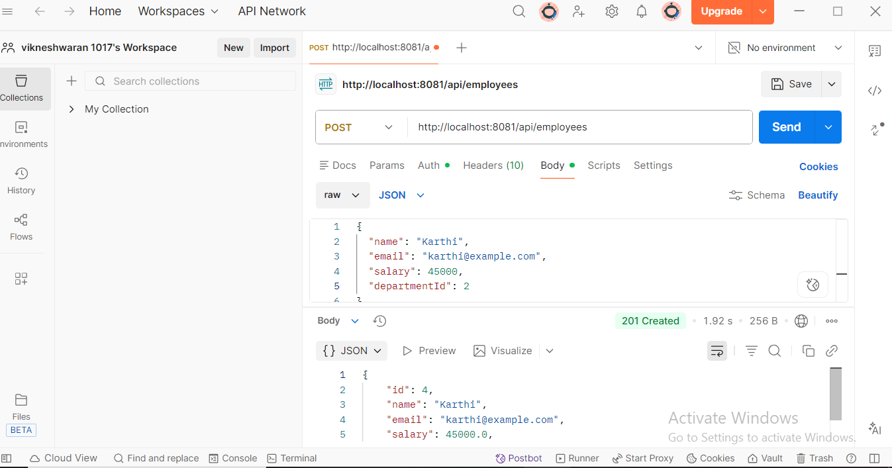
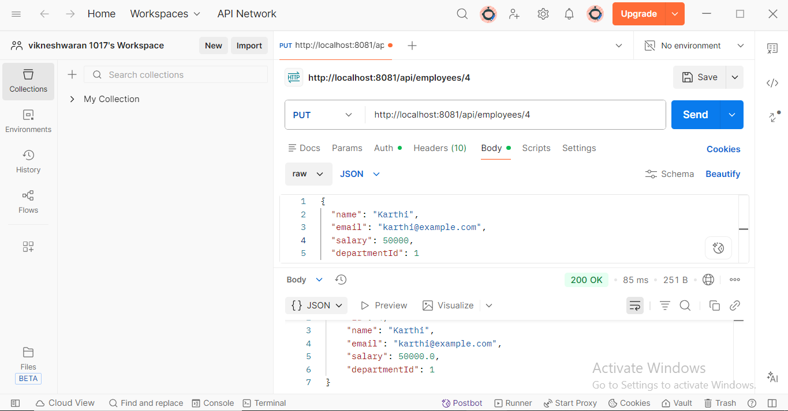
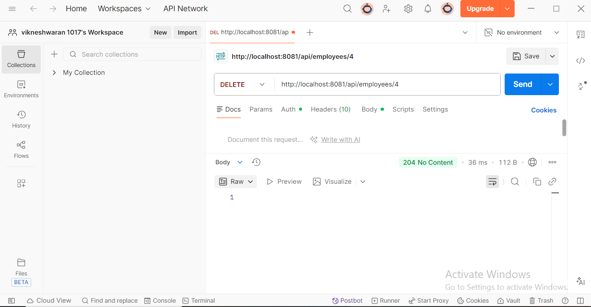
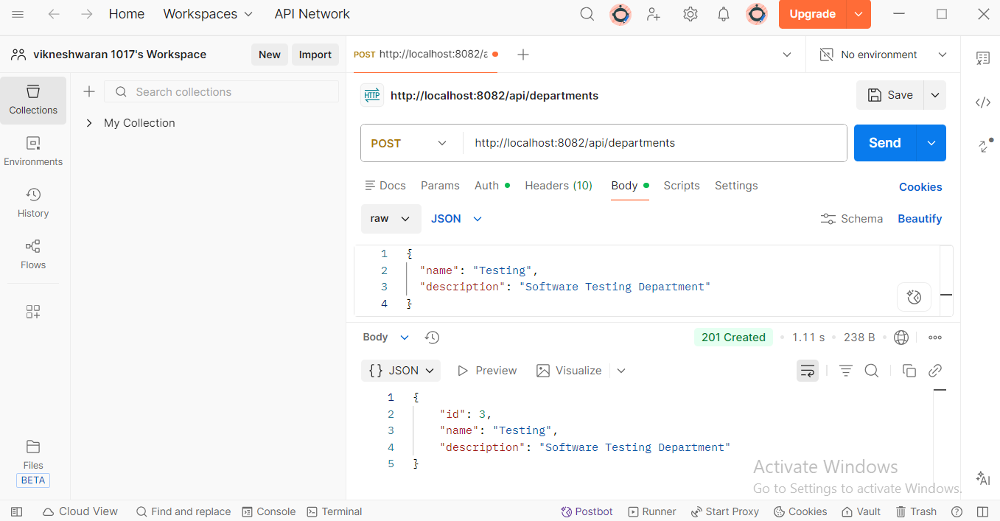
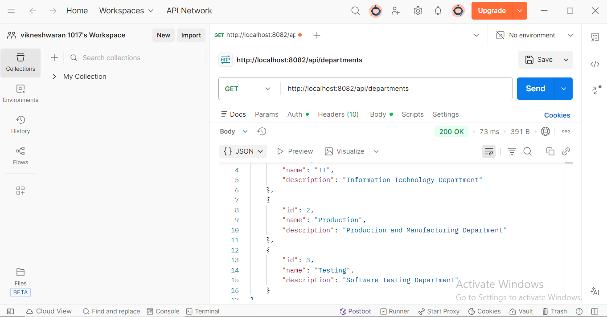
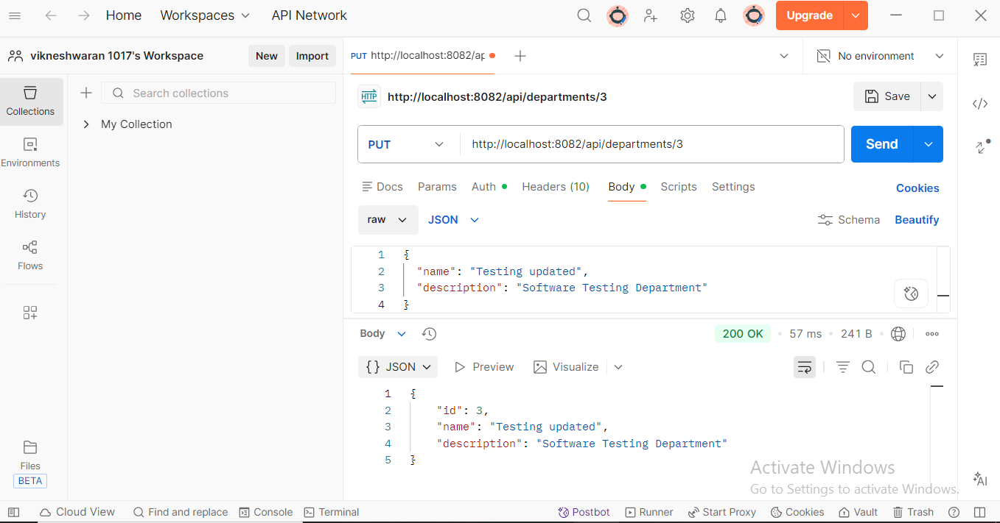
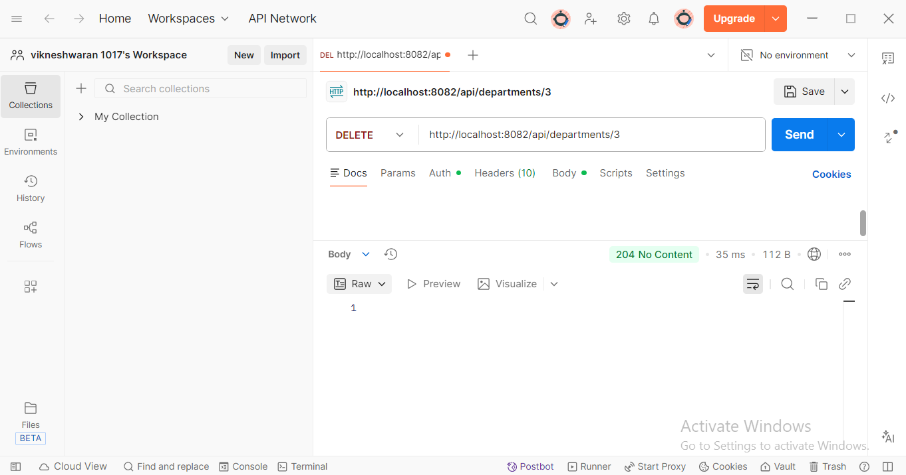
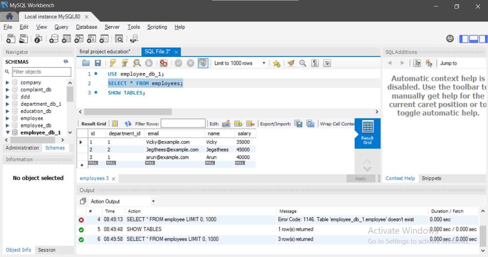
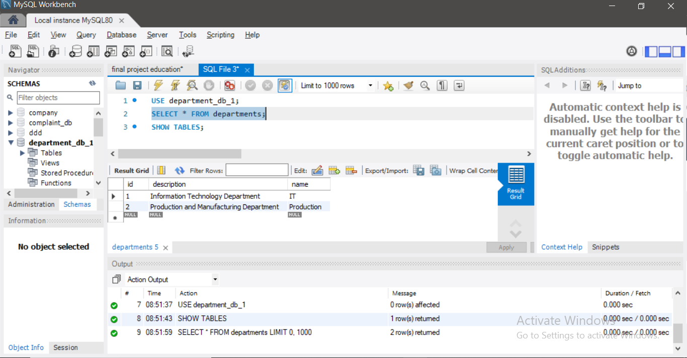

# Employee and Department Microservices

## 1. Project Overview

This project demonstrates a microservices architecture using Java and Spring Boot.

The application consists of two independent microservices:

1. Employee Service
2. Department Service

The Employee Service communicates with the Department Service through REST APIs to retrieve department information.

## 2. Technologies Used

- Java 25
- Spring Boot 4.1.1
- Spring Web
- Spring Data JPA
- MySQL 8
- Maven
- REST APIs
- Spring RestClient
- Bean Validation
- Postman

## 3. Project Structure

```text
employee-department-microservices/
├── employee-service/
│   ├── src/
│   ├── pom.xml
│   └── README.md
├── department-service/
│   ├── src/
│   └── pom.xml
└── README.md
```

## 4. Microservices Configuration

### Employee Service

- Port: 8081
- Database: employee_db_1
- Base URL: http://localhost:8081/api/employees

### Department Service

- Port: 8082
- Database: department_db_1
- Base URL: http://localhost:8082/api/departments

## 5. Features

- Create, retrieve, update, and delete employees.
- Create, retrieve, update, and delete departments.
- Validate request data.
- Handle application exceptions.
- Verify department existence when creating or updating employees.
- Retrieve employee details with department information.
- Communicate between microservices using Spring RestClient.

## 6. Employee API Endpoints

| Method | Endpoint | Description |
|---|---|---|
| POST | /api/employees | Create employee |
| GET | /api/employees | Get all employees |
| GET | /api/employees/{id} | Get employee by ID |
| GET | /api/employees/{id}/details | Get employee and department details |
| PUT | /api/employees/{id} | Update employee |
| DELETE | /api/employees/{id} | Delete employee |

## 7. Department API Endpoints

| Method | Endpoint | Description |
|---|---|---|
| POST | /api/departments | Create department |
| GET | /api/departments | Get all departments |
| GET | /api/departments/{id} | Get department by ID |
| PUT | /api/departments/{id} | Update department |
| DELETE | /api/departments/{id} | Delete department |

## 8. Inter-Service Communication

The Employee Service uses Spring RestClient to communicate with the Department Service.

Example request:

GET http://localhost:8081/api/employees/3/details

Example response:

```json
{
  "id": 3,
  "name": "Arun",
  "email": "arun@example.com",
  "salary": 40000.0,
  "departmentId": 1,
  "department": {
    "id": 1,
    "name": "IT",
    "description": "Information Technology Department"
  }
}
```

## 9. Database Setup

Create the following MySQL databases:

- employee_db_1
- department_db_1

Configure the database URL, username, and password in each service's application.properties file.

Do not upload real database passwords or other secrets to GitHub.

## 10. How to Run the Project

1. Install the required JDK and MySQL.
2. Create both databases in MySQL.
3. Configure the database connection for each service.
4. Start Department Service on port 8082.
5. Start Employee Service on port 8081.
6. Test the APIs using Postman.

Both services must be running for employee requests that depend on department information.

## 11. Testing

The APIs were tested using Postman.

The tests included employee CRUD operations, department CRUD operations, employee details retrieval with department information, and handling invalid department IDs.


## 12. Database Integration and Testing

### Database Configuration
- Employee Service uses MySQL database: `employee_db_1`
- Department Service uses MySQL database: `department_db_1`

### CRUD API Testing
The following operations were tested using Postman:

**Employee Service (Port 8081)**
- Create Employee — POST
- Get All Employees — GET
- Update Employee — PUT
- Delete Employee — DELETE

**Department Service (Port 8082)**
- Create Department — POST
- Get All Departments — GET
- Update Department — PUT
- Delete Department — DELETE

### Testing Evidence
Postman screenshots are available as evidence of API testing and responses.

### Result
The application integrates Spring Boot microservices with MySQL databases and provides REST APIs for employee and department management.


## 13. API and Database Testing Screenshots

The following screenshots demonstrate CRUD API testing
using Postman and database verification using MySQL Workbench.

### Employee Service - Postman Testing

#### 1. Create Employee


#### 2. Get All Employees


#### 3. Update Employee


#### 4. Delete Employee


### Department Service - Postman Testing

#### 5. Create Department


#### 6. Get All Departments


#### 7. Update Department


#### 8. Delete Department


### MySQL Database Verification

#### 9. Employee Database


#### 10. Department Database


## 14. Testing Summary

- Employee CRUD APIs tested using Postman.
- Department CRUD APIs tested using Postman.
- MySQL database records verified using MySQL Workbench.
- API and database testing screenshots documented.
